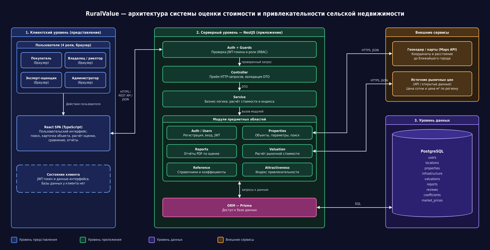
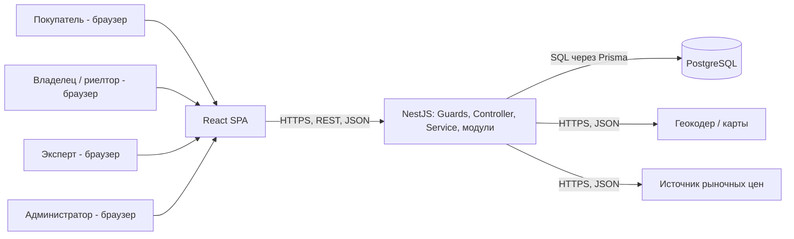

# RuralValue — оценка стоимости и привлекательности сельской недвижимости

Лабораторная работа №1 «Проектирование архитектуры клиент-серверного приложения».
Курс «Разработка клиент-серверных приложений». Программный код в этой работе не пишется: результат — архитектурная документация.

## Предметная область

Выбрана собственная тема: оценка стоимости и привлекательности сельской недвижимости (дома, участки, дачи в сёлах).

**Роли (4, права различаются):**

| Роль | Что может |
| --- | --- |
| Покупатель | искать и сравнивать опубликованные объекты, запускать расчёт стоимости и индекса, формировать отчёт, оставлять отзывы |
| Владелец / риелтор | добавлять, изменять и снимать с публикации **только свои** объекты, видеть оценки своих объектов |
| Эксперт-оценщик | корректировать результат расчёта и оставлять комментарий к оценке |
| Администратор | управлять пользователями, справочником коэффициентов и базовыми ценами по регионам |

**Сущности (9, связаны между собой):**
пользователь (`users`), населённый пункт / регион (`locations`), объект недвижимости (`properties`), параметры инфраструктуры объекта (`infrastructure`), оценка (`valuations`), отчёт (`reports`), отзыв (`reviews`), коэффициент (`coefficients`), рыночная цена региона (`market_prices`).
Связи: объект принадлежит владельцу и находится в населённом пункте; у объекта один набор параметров инфраструктуры; оценка относится к объекту и к пользователю, который её запросил; отчёт строится по оценке; отзыв связывает пользователя и объект; рыночные цены привязаны к региону.

**Операции (12):**
1. регистрация и вход;
2. добавление объекта;
3. изменение и снятие объекта с публикации;
4. поиск и фильтрация объектов;
5. расчёт рыночной стоимости;
6. расчёт индекса привлекательности;
7. сравнение объектов;
8. формирование отчёта PDF;
9. корректировка оценки экспертом;
10. управление справочником коэффициентов;
11. обновление рыночных цен региона;
12. оставление отзыва об объекте.

Вывод: область подходит (≥2 ролей, ≥5 сущностей, ≥8 операций).

## Описание системы

RuralValue — веб-система для оценки стоимости и инвестиционной привлекательности сельской недвижимости: домов, участков и дач в сёлах. Владелец или риелтор вносит объект: регион, площадь участка и дома, состояние дома, наличие дороги, воды, газа, электричества и интернета, удалённость от города. Покупатель находит объекты по региону, цене и индексу привлекательности, запускает расчёт и получает ориентировочную рыночную стоимость и индекс от 0 до 100 с разбивкой по факторам. Эксперт-оценщик может скорректировать результат и оставить комментарий, а администратор управляет коэффициентами и базовыми ценами по регионам. Система заменяет ручные подсчёты в таблицах и оценку «на глаз»: формула и коэффициенты едины для всех объектов, а результат воспроизводим и сохраняется в истории. Права разграничены: покупатель видит опубликованные объекты и свои оценки, владелец — только свои объекты, коэффициенты меняет только администратор.

### Упрощённая модель расчёта

Это учебная модель; она не заменяет официальную оценку.

```
Стоимость = (S_участка × Ц_сотки + S_дома × Ц_м² × К_состояния × К_износа) × К_инфраструктуры
```

- `Ц_сотки` и `Ц_м²` — базовые цены региона из таблицы `market_prices`;
- `К_состояния`, `К_износа`, `К_инфраструктуры` — коэффициенты из таблицы `coefficients` (их меняет администратор);
- `К_инфраструктуры` = 1 + сумма надбавок за дорогу, электричество, воду, газ и интернет.

```
Индекс = (Σ вес_i × оценка_i) / (Σ вес_i) × 100,  оценка_i ∈ [0; 1]
```

Факторы: дорога, электричество, вода, газ, интернет, удалённость от города, состояние дома, социальные объекты рядом. Категории: 75–100 — высокая, 50–74 — средняя, ниже 50 — низкая привлекательность.

## Команда

Азат, группа ИС-21 (индивидуальная работа).

## Роли и сценарии

| ID | Роль | Сценарий | Результат |
| --- | --- | --- | --- |
| UC1 | Владелец / риелтор | Добавляет объект: вводит регион, площади, состояние и параметры инфраструктуры | Объект сохранён, определены координаты и расстояние до города, объект опубликован |
| UC2 | Покупатель | Ищет объекты по региону, диапазону цены и индексу привлекательности | Список карточек объектов с оценкой и индексом |
| UC3 | Покупатель | Запускает расчёт стоимости и индекса привлекательности для выбранного объекта | Сохранена оценка: стоимость, индекс, категория и разбивка по факторам |
| UC4 | Покупатель | Сравнивает 2–3 объекта и формирует отчёт | Таблица сравнения и файл отчёта PDF |
| UC5 | Эксперт-оценщик | Корректирует оценку: задаёт поправку и пишет комментарий | Оценка помечена как проверенная экспертом, значение обновлено |
| UC6 | Администратор | Изменяет коэффициенты и базовые цены региона | Новые значения применяются к следующим расчётам, старые оценки не пересчитываются |

## Архитектура



Исходник схемы: `docs/architecture.drawio`.
Подробное описание компонентов: [docs/components.md](docs/components.md).
Жизненный цикл запроса: [docs/request-lifecycle.md](docs/request-lifecycle.md).

Схема в Mermaid (дополнение к изображению):



## Обоснование решений

**1. Почему трёхуровневая архитектура и что было бы при прямой работе клиента с БД?**
Выбрана схема «интерфейс → backend → база данных». Backend нужен, чтобы строка подключения и пароль от БД никогда не попадали в браузер, а права и расчёт проверялись в одном месте. Если бы React ходил в PostgreSQL напрямую, любой пользователь мог бы прочитать чужие объекты, изменить коэффициенты и подделать оценку, потому что проверок ролей между клиентом и данными не было бы.

**2. Какие данные хранятся в БД, а какие у клиента?**
В БД хранятся пользователи (с хэшами паролей), объекты, параметры инфраструктуры, оценки, отчёты, отзывы, коэффициенты и рыночные цены: всё, что должно сохраняться и быть общим для всех. У клиента лежат только JWT-токен и состояние интерфейса (открытая форма, фильтры поиска). Если бы оценки хранились на клиенте, их можно было бы подделать, а при смене устройства они бы потерялись.

**3. Где применён stateless и как сервер узнаёт, кто отправил запрос?**
Каждый запрос содержит заголовок `Authorization: Bearer <JWT>`; в токене есть идентификатор пользователя и его роль, а Guard проверяет подпись и срок действия. Сессий в памяти сервера нет, всё состояние (оценки, объекты) лежит в БД. Поэтому при пике нагрузки можно запустить несколько экземпляров backend, и любой из них обработает любой запрос. Если бы сессии хранились в памяти, пользователь был бы привязан к одному экземпляру и терял вход при его перезапуске.

**4. Почему монолит и когда стали бы разделять систему?**
Выбран модульный монолит: одно приложение NestJS с модулями Auth, Properties, Valuation, Attractiveness, Reports и Reference. Проект ведёт один человек, расчёту нужны данные нескольких модулей в одной транзакции (оценка и снимок применённых коэффициентов), а развёртывание одного приложения проще. Если расчёты начнут выполняться массово (тысячи объектов в пакетном режиме), модуль Valuation можно выделить в отдельный сервис с очередью: границы модулей для этого уже обозначены.

**5. Какие проверки выполняются на сервере и почему не только на клиенте?**
На сервере проверяются: токен и роль (Guards), права на конкретный объект (владелец меняет только свои), корректность входных данных (площадь больше нуля, допустимые значения параметров, DTO) и сама формула расчёта с коэффициентами из БД. Проверки в браузере легко обойти запросом через curl или правкой кода страницы, поэтому клиентские проверки нужны лишь для удобства пользователя, а не для безопасности. Если бы формула считалась в браузере, любой мог бы изменить коэффициенты и получить нужную стоимость.

## Риски

| Риск | Место на схеме | Последствие | Как снизить |
| --- | --- | --- | --- |
| Геокодер / карты недоступен | Properties → Геокодер | Нельзя определить координаты и расстояние до города при добавлении объекта | Сохранять объект как черновик, дать ввести расстояние вручную, повторить геокодирование позже |
| Устаревшие или неверные рыночные цены региона | Valuation → Источник цен, таблица `market_prices` | Стоимость завышена или занижена, доверие к системе падает | Хранить дату актуализации цены, предупреждать в отчёте при данных старше 30 дней, использовать последние сохранённые цены при недоступности источника, дать эксперту корректировать оценку |
| Ошибочное изменение коэффициентов администратором | Reference, таблица `coefficients` | Массово искажённые оценки | Проверка допустимых диапазонов, хранение снимка применённых коэффициентов в каждой оценке, журнал изменений, доступ только у роли «администратор» |
| Подбор пароля или кража токена | Auth + Guards, канал клиент → backend | Доступ к чужим объектам и оценкам | Хэширование паролей (bcrypt), ограничение числа попыток входа (rate limiting), HTTPS, короткий срок жизни JWT |
| База данных недоступна или данные потеряны | PostgreSQL, ORM | Система не работает, возможна потеря оценок | Регулярные резервные копии, понятное сообщение об ошибке (503), настройка пула соединений |
